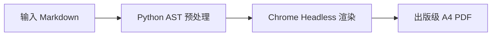

# Markdown 转出版级 A4 PDF 手册（md2pdf + Chrome Headless 引擎）

> 用途：将包含大量 **Mermaid 架构图/时序图/流程图**、**长代码块**、**GFM 复杂表格**的技术方案与工程规格书 Markdown，一键渲染为高保真、防跨页截断、排版美观的出版级 A4 PDF。
> 前提：Linux (Ubuntu / AlmaLinux / Debian) 或 macOS；Python 3.8+；已安装 Google Chrome 或 Chromium。
> 目标：① **Mermaid 本地矢量无损渲染**（不调第三方云端 API，离线可用且不泄密）；② **彻底消灭排版灾难**（SVG 跨页截断、代码块前产生大片空白页、表格内容溢出页边距）；③ **零侵入**，命令行工具链一键集成。
> 已在 Ubuntu 24.04 LTS 与 AlmaLinux 9 验证通过（2026-10）。

---

## 0. 一句话原理（为什么传统的 pandoc / wkhtmltopdf 不行）

传统方案转换技术文档时几乎全部翻车：
- **pandoc + xelatex**：环境庞大（动辄 2~5GB），且天然无法解析前端 JS 动态生成的 Mermaid 图表，遇到中英混排与复杂符号容易报错崩溃。
- **wkhtmltopdf**：基于已废弃十年的 WebKit 内核，不支持现代 CSS Flexbox/Grid，对 ES6 JavaScript 支持残缺，Mermaid 10+ 渲染直接空白。
- **第三方在线图床 API（如 mermaid.ink）**：内网开发或敏感技术文档存在外泄合规风险，且网络波动时经常超时导致 PDF 残缺。

> ✅ **正确架构姿态**：
> `Markdown 源码` → `Python AST 解析与符号预处理` → `自包含 HTML 模板（注入离线 Mermaid.js 与出版级 CSS 打印样式）` → `Chrome Headless (Chromium Blink 引擎) DOM 矢量渲染` → `Page.printToPDF 输出 A4 矢量 PDF`。

---

## 1. 快速安装与环境依赖

### 1.1 一键安装脚本
仓库已内置自动化安装脚本 [scripts/install-md2pdf.sh](scripts/install-md2pdf.sh)，自动检查浏览器、安装 Python 依赖并配置离线 Mermaid.js：

```bash
cd /path/to/aimds
./scripts/install-md2pdf.sh
```

### 1.2 手工分布配置（如在纯净环境）
若需手动安装，仅需执行以下三步：

1. **安装 Chromium 内核浏览器**：
   ```bash
   # Ubuntu / Debian
   sudo apt update && sudo apt install -y google-chrome-stable || sudo apt install -y chromium-browser

   # AlmaLinux / RHEL 9
   sudo dnf install -y chromium
   ```

2. **安装 Python 转换库**：
   ```bash
   pip3 install --user markdown
   ```

3. **下载 Mermaid.js 离线渲染引擎（一次性，5MB）**：
   ```bash
   mkdir -p ~/.local/share/md2pdf
   curl -fsSL -o ~/.local/share/md2pdf/mermaid.min.js "https://cdn.jsdelivr.net/npm/mermaid@10/dist/mermaid.min.js"
   ```

4. **部署 CLI 入口**：
   ```bash
   mkdir -p ~/.local/bin
   cp scripts/md2pdf.py ~/.local/bin/md2pdf
   chmod +x ~/.local/bin/md2pdf
   ```

---

## 2. CLI 使用方式

工具已注册为标准 CLI 命令 `md2pdf`（只要 `~/.local/bin` 在 `$PATH` 中）：

```bash
# 基础用法：输入 .md，自动在同目录下生成同名 .pdf
md2pdf <input.md>

# 指定输出 PDF 路径
md2pdf <input.md> <output.pdf>

# 调整图表复杂场景下的渲染超时时间（默认 15 秒）
md2pdf <input.md> <output.pdf> --timeout 30
```

---

## 3. 核心排版规范与反截断设计要点

为了保证导出的 PDF 具备出版物级观感，本工具在 CSS 与 DOM 解析层做了针对性优化：

### 3.1 跨页空白控制（避免代码块前大片空白）
* **痛点**：默认浏览器打印时对 `<pre>` 代码块采用 `page-break-inside: avoid`，当一个代码块长度超过半页时，Chrome 会强行将其推到下一页，导致上一页留下高达半页的难看空白。
* **解法**：在打印样式中设置 `pre { page-break-inside: auto !important; break-inside: auto !important; }`，允许长代码块在行间自然断页，同时为代码块增加轻量边框与背景，保持代码连贯性。

### 3.2 Mermaid 矢量自适应与防截断
* **痛点**：宽幅架构图或高时序图如果强行分页，会被垂直切成两半，文字被拦腰截断。
* **解法**：
  1. 容器声明：`.mermaid-wrapper { page-break-inside: avoid !important; break-inside: avoid !important; }`；
  2. 尺寸自适应：限制最大高度 `.mermaid-wrapper svg { max-height: 460px !important; max-width: 100% !important; height: auto !important; }`，当图表过大时自动按比例矢量缩小，确保一张图完整保留在单页内。
  3. 布局建议：绘制大型架构图时，优先使用 `flowchart LR` 或多层级紧凑排版，避免绘制纵深超过 15 层的超长 `flowchart TD`。

### 3.3 A4 标准尺寸与页边距
* 页面尺寸严格固定为国际标准 A4：`@page { size: A4 portrait; margin: 16mm 14mm 16mm 14mm; }`。
* 字体层叠：优先调用系统无衬线抗锯齿字体族（PingFang SC, Noto Sans CJK SC, Microsoft YaHei），代码块采用 JetBrains Mono / SFMono，确保在 Linux、macOS 与 Windows 跨平台渲染一致。

### 3.4 列表内代码块顶格归一化自适应与防挤压
* **痛点**：在编写工程文档时，常在有序或无序列表子条目中嵌入代码块（前面带有 2~6 个空格缩进）。`python-markdown` 的 `fenced_code` 扩展默认仅匹配行首围栏，缩进超过 3 个空格时无法识别为独立代码块，会将反引号（```` ``` ````）及多行代码折叠为单行普通文本输出，造成严重挤压与语法泄露。
* **解法**：脚本内置 `normalize_fenced_code` 归一化层，在 Markdown 解析前自动将各类嵌套缩进的代码块围栏顶格对齐，并等比消除公共缩进；同时优化代码样式至 `line-height: 1.6`、`margin: 12px 0 16px 0`，确保代码段结构清晰且视觉透气。

---

## 4. 关键步骤验证与测试

通过以下三条命令验证整套工具链是否完备：

```bash
# 1. 检查 CLI 是否正常识别
command -v md2pdf && md2pdf --help

# 2. 验证 Chrome 无头运行权限（非 root 环境验证）
google-chrome --headless=new --disable-gpu --no-sandbox --dump-dom "about:blank" >/dev/null && echo "Chrome Headless OK"

# 3. 创建测试文件并验证 Mermaid 与表格导出
cat << 'EOF' > /tmp/test_render.md
# PDF 导出测试

| 功能模块 | 验证状态 | 备注 |
| :--- | :--- | :--- |
| GFM 表格 | 正常 | 边框与自适应 |
| Mermaid 矢量图 | 正常 | 流程图无损渲染 |


EOF

md2pdf /tmp/test_render.md /tmp/test_render.pdf
ls -lh /tmp/test_render.pdf
```

---

## 5. 排错速查表（症状 → 原因 → 解法）

| 症状 | 常见原因 | 解决方案 |
|---|---|---|
| `❌ 生成 PDF 失败: google-chrome: not found` | 宿主机未安装 Chromium 或可执行文件不在系统 PATH | `sudo apt install -y chromium-browser` 或建立软链接：`sudo ln -s /usr/bin/chromium /usr/bin/google-chrome` |
| `Running as root without --no-sandbox is not supported` | 在 Docker 或 root 容器中运行，Chrome 沙箱机制拒绝启动 | 脚本内部已默认追加 `--no-sandbox` 标志；若自定义调用务必加上 `--no-sandbox` 参数 |
| PDF 中 Mermaid 区域显示为红字 `[图表加载重试中...]` 或空白 | ① 语法错误（如节点名称包含未加双引号的括号 `id[A (B)]`）；② 离线资源未就绪且机器无法访问外网 CDN | ① 语法检查：将特殊字符用英文双引号包裹，如 `id["A (B)"]`；② 执行 `install-md2pdf.sh` 确保离线 `mermaid.min.js` 正确放置在 `~/.local/share/md2pdf/` |
| 导出的 PDF 中文字体全变成小方块或乱码豆腐块 | Linux 服务器环境缺少中文字体库（如纯净 minimal 安装） | 安装中文字体包：`sudo apt install -y fonts-noto-cjk fonts-wqy-zenhei` 或 `sudo dnf install -y google-noto-sans-cjk-fonts` |
| Mermaid 时序图参与者（Actor）在底部也重复显示一行 | Mermaid 默认开启了 `mirrorActors` 属性 | 脚本中已预置配置关闭镜像：`sequence: { mirrorActors: false }`，无需手动在 Markdown 中干预 |
| 长表格右侧列被截断在页面外 | 表格列数过多或单列包含无空格长字符串破坏换行 | 在表格对应列中使用 `<br>` 手工换行，或在 CSS 中确保 `table { word-break: break-word; }` 生效 |
| 生成的 PDF 尾部出现一两页完全空白的页面 | 打印 CSS 中有浮动元素高度溢出触发打印机边界换页 | 检查 Markdown 末尾是否有连续空行，或确保使用最新版 `md2pdf.py`（已清空末尾孤立边距） |
| 特殊符号如 `\rightarrow` 被转换为奇怪字符 | Markdown 解析器误将 LaTeX 符号按转义字符吃掉 | 脚本已包含输入规整层，自动将 `\rightarrow` 与 `$\rightarrow$` 提前转换为 Unicode 字符 `→` |
| 列表内代码块反引号泄露或整段代码挤成一行 | `python-markdown` 默认对缩进代码围栏解析异常 | 脚本已内置 `normalize_fenced_code` 自动将缩进代码块顶格归一化，确保生成独立语法高亮代码块 |
