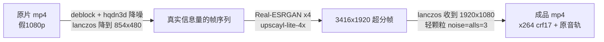

# 老视频 AI 修复 Runbook（Real-ESRGAN 三阶段流水线）

> **用途**：把老电视录像画质（歌仔戏、老剧、老动画）修复成 1080P 高清。一条命令批量整部剧，断点续跑。
> **前提**：`ffmpeg`/`ffprobe` 已装；`realesrgan-ncnn-vulkan` 二进制 + 模型（脚本会自动找，Linux 缺失时自动下载官方包）。
> **目标**：`./video-restore.sh 某剧文件夹` → 输出 `某剧_fixed/*.mp4`（1920×1080, x264 crf17, 原音轨）。

- 脚本：[scripts/video-restore.sh](scripts/video-restore.sh)（Mac / NVIDIA / 云GPU 统一，自动调优）
- 模型：[scripts/models/](scripts/models/) 已内置默认模型 `upscayl-lite-4x`（其余模型见 §6）

---

## 1. 一句话跑起来

```bash
git clone git@github.com:gengshenchen/aimds.git && cd aimds

# Mac（自动用保守 tile，验证过的参数）
./scripts/video-restore.sh /path/to/剧名文件夹 [输出目录]

# NVIDIA 台式机 / 云GPU（自动检测 nvidia-smi，整帧不切 tile，多线程）
./scripts/video-restore.sh /path/to/剧名文件夹 [输出目录]
```

- 不给输出目录时：默认 `/Volumes/Elements/歌仔戏修复/`（不存在则 `~/video_restore_out/`）
- 单文件也行：`./scripts/video-restore.sh /path/to/第01集.mp4`
- 换细节版模型：`SR_MODEL=realesrgan-x4plus ./scripts/video-restore.sh ...`（慢约 13 倍，对已跑集数自动重跑超分阶段，不混用）

## 2. 三阶段流水线（为什么这么设计）



| 阶段 | 工具/参数 | 为什么 |
|---|---|---|
| ① 清洗 | `deblock=filter=weak,hqdn3d=1.5:1.5:4:4` + 降 `854×480` | YouTube 的"1080p"多为 480p 拉大的**假高清**。先降到真实信息量、去块去噪，超分才不会把压缩瑕疵一起放大 |
| ② 超分 | `realesrgan-ncnn-vulkan -n upscayl-lite-4x -s 4` | 轻量模型人脸自然（选型时对比过：`realesrgan-x4plus` 细节锐但慢13倍；Topaz Video AI 会把眼睛修变形，弃用） |
| ③ 合成 | `scale=1920:1080 lanczos` + `noise=alls=3:allf=t` 颗粒 + `libx264 crf17 medium` | 超分后轻微收锐 + 一点点动态颗粒，避免"AI 塑料感"；crf17 近乎无损画质；音频 aac 直拷 |

**模型选型速查**（`-n` 参数 / `SR_MODEL` 环境变量）：

| 模型 | 速度(M1基准) | 特点 |
|---|---|---|
| `upscayl-lite-4x` ✅默认 | ~1 秒/帧 | 快、人脸自然、整体观感最好 |
| `realesrgan-x4plus` | ~13 秒/帧 | 细节更锐（毛发/纹理），慢；眼睛偶有瑕疵 |
| `realesr-animevideov3-x4` | ~0.5 秒/帧 | 动画专用，真人视频不适用 |

## 3. 速度基准（一个 24 分钟 ≈ 43000 帧）

| 硬件 | 秒/帧 | 单集耗时 | 备注 |
|---|---|---|---|
| Apple M1 | ~1.0 | ~12h | 功耗低可 24h 挂机 |
| RTX 3060 12G | ~0.2 | ~2.5h | 二手 ~¥1300 |
| RTX 3090 24G | ~0.08 | ~1h | 云租 ~¥1.5-2/时 |
| RTX 4090 24G | ~0.05 | ~35min | 云租 ~¥1.9/时 |

## 4. 断点续跑与批量挂机

脚本自身的续跑机制（**中断后重跑同一条命令即可接着干**）：

| 标记 | 作用 |
|---|---|
| 成品 `xxx.mp4` 已存在 | 整集跳过 `SKIP` |
| `.work/剧__集/.stage1_done` | 阶段①抽帧已完成，跳过 |
| `.work/剧__集/frames_out/` 帧数 == 输入帧数 | 阶段②超分已完成，跳过 |
| `.work/剧__集/.model` ≠ 当前模型 | 自动重跑超分（不混用不同模型输出） |
| 集成功后 | `.work` 工作区自动删除 |

后台批量挂机模板：

```bash
# Mac（caffeinate 防休眠）
nohup caffeinate -is ./scripts/video-restore.sh /path/to/剧名文件夹 \
  > ~/restore_剧名.log 2>&1 &
echo $! > ~/restore.pid

# 看进度
grep -E "DONE|SKIP|\[" ~/restore_剧名.log | tail
```

> 磁盘提醒：`.work` 工作区每集峰值约几十 GB（PNG 输入帧 + JPG 超分帧），保证输出盘有 ~100GB/集 余量。

## 5. Mac 环境

```bash
brew install ffmpeg   # 前提
# realesrgan-ncnn-vulkan：从 Real-ESRGAN 官方 release 取对应平台包解压，
# 放进 ~/gezai_restore/sr_tool/（含二进制 + models/ 全套模型）——本机已就位
# 首次运行若提示"无法验证开发者"：
sudo xattr -d com.apple.quarantine ~/gezai_restore/sr_tool/realesrgan-ncnn-vulkan
```

默认模型已内置在 `scripts/models/`，`x4plus` 等其他模型把官方包里 `models/` 的 `.bin/.param` 拷进 `~/gezai_restore/sr_tool/models/` 即可。

## 6. NVIDIA / 云GPU（AutoDL 等）

脚本检测到 `nvidia-smi` 后自动切到 NVIDIA 调优：`-t 0`（整帧不切 tile）+ `-j 2:2:4`；Linux 缺二进制时自动下载官方 ubuntu 包。

```bash
# AutoDL 开箱流程（选带 CUDA 驱动的镜像，如 PyTorch 基础镜像）：
apt update && apt install -y libvulkan1 unzip
git clone https://github.com/gengshenchen/aimds.git && cd aimds

# 上传原片（或先无卡模式开机传片更省钱，再切有卡）
scp -P <端口> 本地/剧名 root@<主机>:/root/aimds/input/

# 跑（首跑自动下载二进制）
./scripts/video-restore.sh input/剧名文件夹 /root/aimds/out

# 传回成品后随手关机（按秒计费，不停就是烧钱）
scp -P <端口> -r root@<主机>:/root/aimds/out/剧名_fixed ./
```

**成本估算**：整库 329 集 ≈ 2600 万帧 ≈ 3090 上 700 GPU 时；4090 约 350 时 × ¥1.9 ≈ **¥700 全库**。

## 7. 验证成品

```bash
# 分辨率/帧率应为 1920x1080
ffprobe -v error -select_streams v:0 -show_entries stream=width,height -of csv=p=0 某集_fixed/第01集.mp4

# 抽同一时间点原片 vs 修复片对比看效果
ffmpeg -ss 00:10:00 -i 原片.mp4 -frames:v 1 /tmp/a.png
ffmpeg -ss 00:10:00 -i 某集_fixed/第01集.mp4 -frames:v 1 /tmp/b.png && open /tmp/a.png /tmp/b.png
```

## 8. 排错速查表

| 症状 | 原因 | 解法 |
|---|---|---|
| `vkAllocateMemory failed` / 显存爆 | tile 过大 | `TILE=256 ./scripts/video-restore.sh ...`（NVIDIA 大卡一般不会） |
| `ERROR: 找不到 realesrgan-ncnn-vulkan` | 二进制不在默认位置 | `RE_BIN=/路径/realesrgan-ncnn-vulkan` 或放 `TOOL_DIR` |
| `ERROR: 找不到模型 xxx` | models 目录缺该模型 | 从官方包拷 `.bin/.param` 到 `scripts/models/` 或 `TOOL_DIR/models/` |
| Mac 提示"无法验证开发者" | Gatekeeper | `sudo xattr -d com.apple.quarantine <二进制>` |
| Linux 报 no Vulkan device | 缺 libvulkan1 或驱动 | `apt install libvulkan1`；`nvidia-smi` 确认驱动在 |
| 阶段① `FAIL extract` | 源文件损坏/编码特殊 | 单独处理该集；`ffmpeg -v error -i 文件` 看具体报错 |
| 画面太"糊/塑料"或太锐 | 模型观感不合口味 | `SR_MODEL=realesrgan-x4plus` 切细节版（或换回默认） |
| 集数中断想继续 | —— | 直接重跑同一条命令，自动续 |
| 磁盘爆 | `.work` 峰值大 | 换大容量输出盘；删 `.work` 会丢进度重抽帧 |

## 9. 本机部署状态（karl 的 Mac）

- 生产版 v2：`~/gezai_restore/restore.sh`（Mac 专用，逻辑与 repo 版一致；**正在跑批次时别改它**，bash 边读边执行）
- repo 版 v3：`scripts/video-restore.sh`（新增 GPU 自动调优/自动下载/目录自适应），当前批次跑完后可整体切到 repo 版
